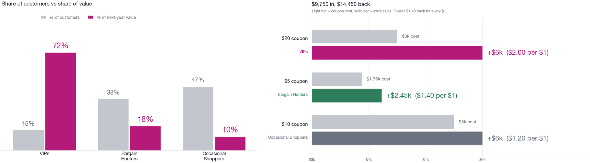
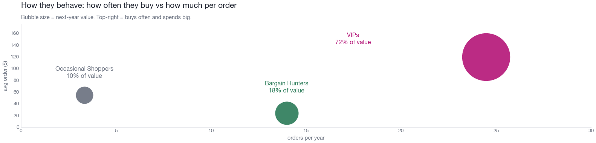
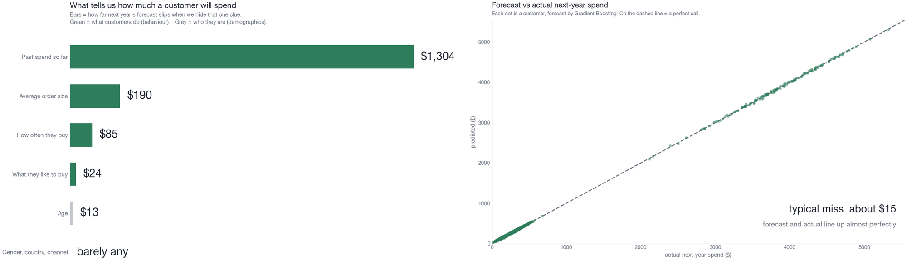
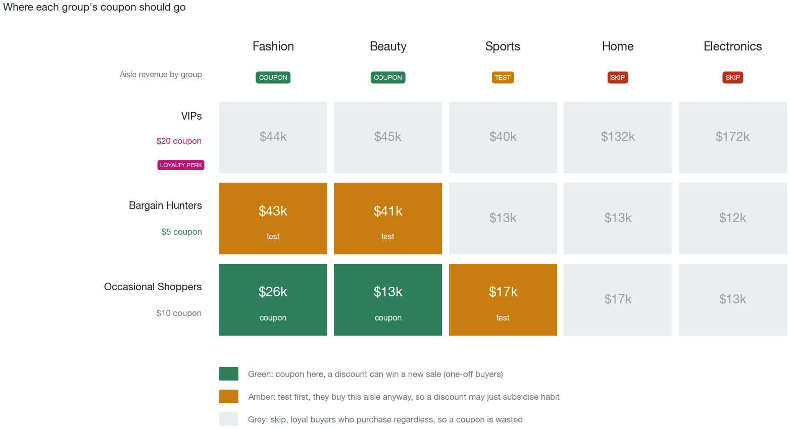
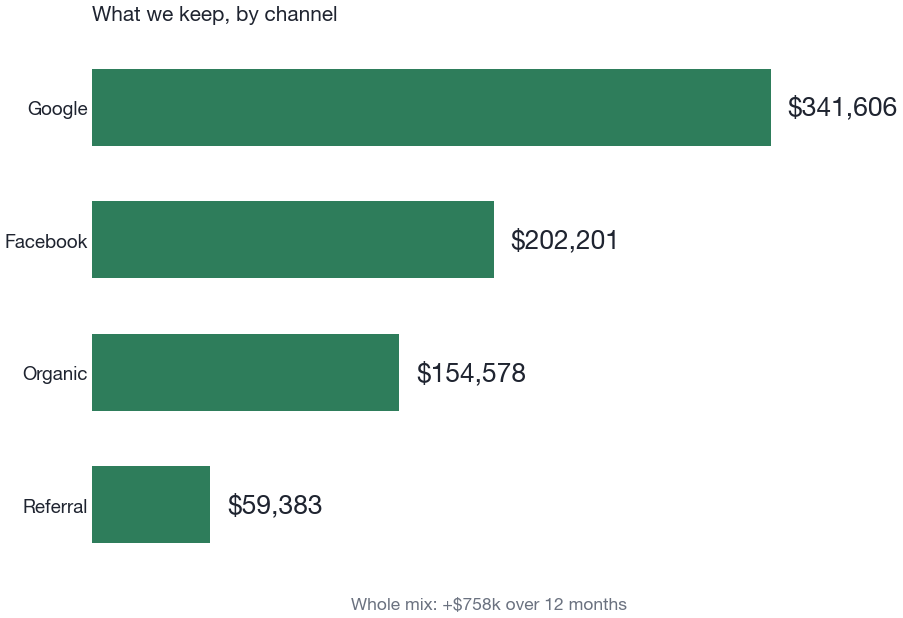

<h1 align="center">E-commerce customer analytics</h1>

<p align="center">
  <b>Find the customers who matter, predict what they will spend next year, and put a $10,000 promotion budget where it pays.</b><br>
  Customer segmentation (k-means with a k-NN classifier), 12-month customer lifetime value prediction, an integer program for coupon allocation, SQL for customer and channel profitability, and a business deck, on a synthetic dataset of 1,000 customers and 10,503 transactions.
</p>

<p align="center">
  
  
  
  
  <a href="LICENSE"></a>
</p>

<p align="center"></p>
<p align="center"><sub><i>Share of customers against share of next-year value by segment, and the optimised coupon plan. Charts from the business deck, redrawn from the data in <code>scripts/presentation.ipynb</code>.</i></sub></p>

<p align="center">
  <a href="#at-a-glance">At a glance</a> ·
  <a href="#results">Results</a> ·
  <a href="#how-it-works">How it works</a> ·
  <a href="#run-it">Run it</a> ·
  <a href="#repository-layout">Repository layout</a> ·
  <a href="#context">Context</a>
</p>

---

## At a glance

| Part | Question | Method | Result |
|---|---|---|---|
| 1. Segmentation | Which groups of customers behave alike? | RFM and behavioural features, k-means, k-NN classifier for new customers | 3 segments (silhouette 0.565); k-NN with k = 5 assigns new customers with 99.2% held-out accuracy |
| 2. Customer lifetime value | What will each customer spend in the next 12 months? | Five regressors compared over 25 repeated splits; gradient boosting kept | Held-out RMSE $23.94, MAE $14.90, R² 0.9996 |
| 3. Budget | Which coupon should each segment get under a $10,000 budget? | Integer linear program (`scipy.optimize.milp`), checked by exhaustive search and by `lpSolve` in R | $9,750 spent returns $14,450 net incremental revenue |
| 4. SQL | What does each customer look like, and which acquisition channel pays? | Customer profile aggregator and channel ROI query with window functions | Google 23.3x, Facebook 21.6x, Referral 16.0x; Organic is free |
| 5. Deck | What should marketing do next? | Seven-slide deck, every number recomputed in a notebook | Retain VIPs, run the coupon plan as an A/B test, grow the base |

## Results

### Segments

Features are built per customer from the transaction log and the customer profile. The elbow method and a silhouette score of 0.565 both point to three clusters, named from their profiles:

| Segment | Customers | Revenue share | Avg spend | Avg purchases | Avg order | Median recency | Reading |
|---|---|---|---|---|---|---|---|
| **VIPs** | 148 (15%) | **68%** | $2,925 | 24.5 | $119 | 18 days | recent, very frequent, large premium baskets: protect and retain |
| **Bargain Hunters** | 380 (38%) | 19% | $319 | 14.0 | $24 | 26 days | frequent, small budget baskets: promotions convert them |
| **Occasional Shoppers** | 472 (47%) | 13% | $183 | 3.3 | $55 | 116 days | lapsed and infrequent: reactivation and win-back |

<p align="center"></p>

A k-nearest-neighbours classifier assigns new customers to these segments. Five-fold cross-validation over odd k from 3 to 25 picks k = 5, with 99.2% held-out accuracy and macro-F1 0.994; the segments are well separated, which is why the classifier finds them easily. The segment-score equations are written out in [models/README.md](models/README.md).

### Next-year value

<p align="center"></p>
<p align="center"><sub><i>What the value model relies on (left) and forecast against actual spend on held-out customers (right). From the business deck, redrawn in <code>scripts/presentation.ipynb</code>.</i></sub></p>

Linear, ridge, lasso, random forest and gradient boosting regressors were compared over 25 repeated 75/25 splits, and gradient boosting was kept. On the held-out set it scores RMSE $23.94, MAE $14.90 and R² 0.9996. RMSE is the selection metric because a large miss on a high-value customer is the expensive mistake; MAE, about $15, is the plain typical error for a business audience. A learning curve and a validation curve show that shallow trees (depth 3) keep training and held-out error close, and the held-out set is never used to choose the model. Past spend carries almost all of the signal; demographics add next to nothing, so targeting should follow behaviour.

### Coupon budget

The allocation is solved exactly as an integer linear program and cross-checked by exhaustive search over all 64 plans and by `lpSolve` in R:

| Segment | Coupon | Spend | Net incremental revenue |
|---|---|---|---|
| VIPs | $20 | $3,000 | $6,000 |
| Bargain Hunters | $5 | $1,750 | $2,450 |
| Occasional Shoppers | $10 | $5,000 | $6,000 |
| **Total** | | **$9,750** | **$14,450** |

The budget binds. Giving every segment its own best coupon would cost $11,500, so the solver trims the Bargain Hunters coupon, the lowest return per extra dollar, and gives up $350 of net revenue to stay within $10,000. The scenario's segment sizes for this part (VIPs 150, Bargain Hunters 350, Occasional Shoppers 500) are fixed inputs; the clustering itself gives 148 / 380 / 472.

<p align="center"></p>
<p align="center"><sub><i>Where each segment's coupon should apply, by product category. From the business deck, redrawn in <code>scripts/presentation.ipynb</code>.</i></sub></p>

### Channels (SQL)

`sql/sql_solutions.sql` is written for Snowflake and commented line by line; [sql/README.md](sql/README.md) explains each query's purpose, columns, logic and assumptions.

- **Customer profile aggregator:** one row per customer with total spend, transaction count, average order value, recency in days (`DATEDIFF`) and the first category bought (`ROW_NUMBER()`).
- **Channel ROI:** one row per acquisition channel. Signups use `COUNT(DISTINCT customer_id)` because one customer has many transactions. The query computes acquisition cost, historical spend, revenue share paid, net channel profit and ROI = net profit / (acquisition cost + revenue share), with `NULLIF` guarding the free Organic channel, then ranks channels with `RANK()`.

| Channel | Signups | Net profit | ROI |
|---|---|---|---|
| Google | 404 | $274,848 | 23.3x |
| Facebook | 298 | $166,645 | 21.6x |
| Referral | 92 | $48,873 | 16.0x |
| Organic | 206 | $127,397 | no acquisition cost, so ROI is undefined |

Organic's ROI denominator is zero, so its ROI is `NULL` and its rank depends on the engine: Snowflake sorts NULLs first under `DESC` (rank 1), SQLite last (rank 4). The figures above come from SQLite, which the notebook uses for its cross-check. Organic's story is $127,397 of profit at no acquisition cost rather than a place in an ROI ranking.

<p align="center"></p>
<p align="center"><sub><i>What each acquisition channel keeps over the next 12 months, as shown in the deck. Redrawn in <code>scripts/presentation.ipynb</code>.</i></sub></p>

### Business deck

[`Business-Presentation.pptx`](Business-Presentation.pptx) has seven slides: a title slide, five content slides (executive summary and financial impact, customer segments, CLV drivers and predictability, the coupon plan and its return, and a roadmap of next experiments) and a closing slide.

`scripts/presentation.ipynb` is the deck's audit trail. It recomputes every number in the deck from `data/`, `outputs/` and `models/` and prints the deck's wording beside the recomputed value, one section per content slide. It also redraws all 12 of the deck's figures from the data, and refits the three-question decision tree, so its splits are the model's real thresholds.

| Notebook section (deck slide) | Claims checked |
|---|---|
| 1 · Executive summary (slide 2) | 15% of customers hold 72% of next-year value; a VIP is worth about 23x an Occasional Shopper; the acquisition mix keeps +$758k over 12 months; the $10k coupon plan returns +$14,450 (1.48x) |
| 2 · Customer segments (slide 3) | segment sizes, values and behaviour (orders a year, average order, recency); premium categories give 56% of revenue from 39% of purchases |
| 3 · CLV insights (slide 4) | past spend dominates the drivers (about $1,304, roughly 7x the next); demographics add about $0; the model predicts within about $15; it reduces to three yes/no questions |
| 4 · Coupon strategy (slide 5) | VIPs $20, Bargain Hunters $5, Occasional Shoppers $10, returning +$14,450 net on $9,750 (1.48x, $250 unspent) |
| 5 · Roadmap (slide 6) | the lapsed pool (about 100 customers, about 1.6% of value, no VIPs); the prize to scale: coupon $14,450, growing the base $195k, restarting acquisition $758k |

## How it works

- **Leakage firewall.** Transactions end on 2026-06-30 and the target covers the 12 months after. Every feature uses only data before the cut-off, and the recency reference date is derived from the data (the day after the last transaction), so the code stays leak-safe if the data is refreshed.
- **Segmentation features.** RFM (recency, frequency, monetary), average order value, tenure, active span, category diversity, per-category spend shares and demographics. The four RFM drivers are `log1p`-transformed to tame skew and then standardised. Clustering on RFM plus average order value separates Bargain Hunters (frequent, cheap baskets) from VIPs (frequent, large baskets), which frequency alone would miss.
- **Value model.** Chosen by repeated cross-validation rather than one lucky split; a shallow surrogate tree explains it as three yes/no questions. Model equations and importances are in [models/README.md](models/README.md).
- **Budget.** An exact integer program rather than a heuristic, so the coupon plan is provably optimal; `scripts/budget_optimization.py --config` solves new scenarios from a JSON file ([example](scripts/scenario.json)).
- **What drives value.** The one strong relationship is behaviour to category (Cramér's V about 0.55 at customer level): VIPs lean to premium categories, Bargain Hunters to budget ones, in every country. Country, gender and acquisition channel are statistically independent of value, so targeting is by segment.
- **SQL.** Every customer has at least one transaction (checked), so the profile query returns one row per customer.

## Run it

Python 3.9 or newer (the code was written on 3.9.6):

```bash
python3 -m venv .venv && source .venv/bin/activate      # Windows: .venv\Scripts\activate
python3 -m pip install --upgrade pip
python3 -m pip install pandas numpy scikit-learn scipy matplotlib seaborn joblib jupyter
```

From the repository root (defaults read `data/` and write `models/` and `outputs/`):

```bash
python3 scripts/customer_segmentation.py     # Part 1: segments and the k-NN classifier
python3 scripts/clv_regression.py            # Part 2: value model and metrics
python3 scripts/budget_optimization.py       # Part 3: coupon plan (also refreshes outputs/results_summary.json)
python3 scripts/score_customers.py --data-dir NEW_DATA_FOLDER   # score new customers with both saved models
```

The executed notebooks and the R alternative (it installs `lpSolve` on first run):

```bash
jupyter notebook scripts/solutions.ipynb       # every part, every figure; Restart and Run All
jupyter notebook scripts/presentation.ipynb    # recomputes the deck; run after the scripts
Rscript scripts/variable_analysis_and_budget_optimization.R   # writes outputs/variable_analysis_and_budget_optimization.txt
```

Every script takes arguments (data and output folders, seed, number of clusters, tree depth, budget scenario, `--predict` mode); [scripts/README.md](scripts/README.md) lists them with copy-paste commands. `random_state = 42` is used throughout, and the scripts and the notebook produce the same headline numbers. The headline figures are also written to `outputs/results_summary.json`:

```json
{
  "segment_sizes": { "vip": 148, "bargain": 380, "occasional": 472 },
  "clv_test_error": { "rmse": 23.94, "mae": 14.9 },
  "coupon_per_customer": { "vip": 20, "bargain": 5, "occasional": 10 },
  "expected_net_revenue": 14450
}
```

## Repository layout

```text
E-Commerce-Customer-Analytics/
├── data/                          # the four input tables (synthetic)
├── models/                        # trained artefacts reused for prediction (see models/README.md)
├── outputs/                       # result tables, results_summary.json and the R report (see outputs/README.md)
├── scripts/
│   ├── feature_engineering.py         # shared: raw tables to one leak-safe row per customer
│   ├── customer_segmentation.py       # Part 1: k-means and k-NN, or --predict new customers
│   ├── clv_regression.py              # Part 2: value model, or --predict new customers
│   ├── budget_optimization.py         # Part 3: coupon integer program; --config for new scenarios
│   ├── score_customers.py             # segment and value for new customers, no retraining
│   ├── scenario.json                  # example budget scenario
│   ├── solutions.ipynb                # executed end-to-end notebook, Parts 1 to 4
│   ├── presentation.ipynb             # recomputes every number and figure in the deck
│   └── variable_analysis_and_budget_optimization.R   # R alternative: variable analysis and LP
├── sql/                           # Part 4: sql_solutions.sql and its write-up
├── docs/images/                   # figures for this page
└── Business-Presentation.pptx     # Part 5: the deck
```

## Data

A synthetic e-commerce dataset in `data/`: 1,000 customers in five countries (AU, CA, DE, UK, US), 10,503 transactions from 1 January 2025 to 30 June 2026, the spend of each customer over the following 12 months, and the economics of four acquisition channels.

| File | Columns |
|---|---|
| `customers.csv` | `customer_id`, `age`, `gender`, `country`, `signup_date`, `acquisition_channel` |
| `transactions.csv` | `transaction_id`, `customer_id`, `transaction_date`, `amount`, `category` |
| `clv_targets.csv` | `customer_id`, `target_clv_next_12_months` (spend from 1 July 2026 to 30 June 2027) |
| `channels.csv` | `channel_name`, `cost_per_signup`, `revenue_share_rate` |

## Context

Completed as a data-science interview case study. The company, the people involved and the original task brief are not included, and the dataset is synthetic.

## Notes and limitations

- The CLV R² near 0.999 reflects a low-noise synthetic target in which past spend tracks future spend almost perfectly; real data would be much harder to predict.
- Gradient boosting cannot extrapolate beyond its training range, so it slightly under-predicts the extreme VIP tail, where a linear model or a blend is safer.
- The k-NN accuracy measures how well it recovers the k-means partition, not skill against independent labels.

## Licence

Code is released under the [MIT licence](LICENSE).
